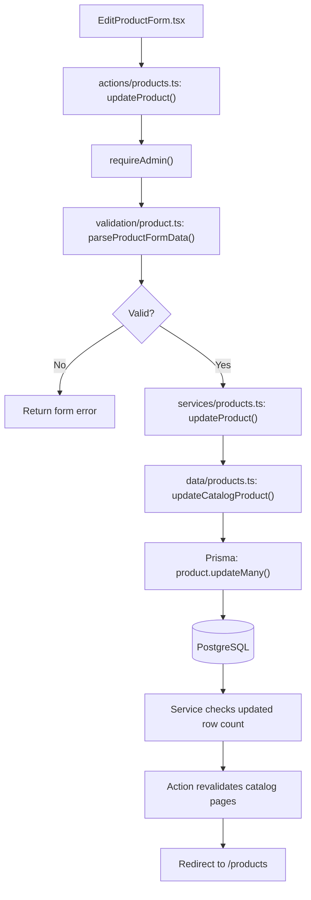
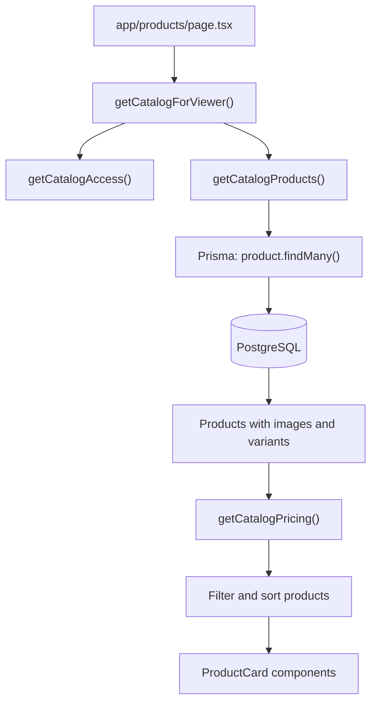
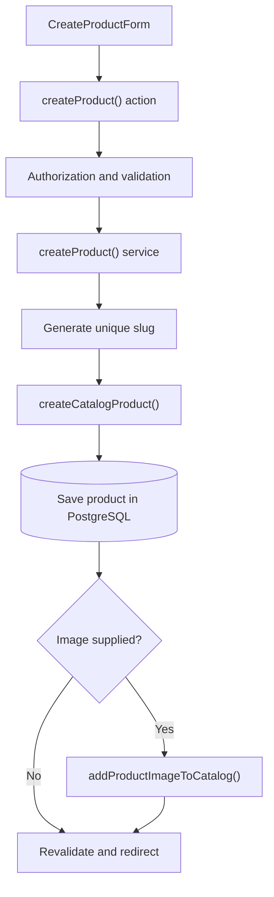
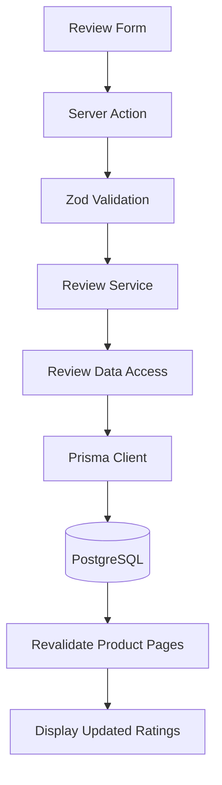

# E-Commerce Starter — Architecture & Data Flow

## Purpose

This document explains how our Next.js e-commerce application is organized, how data moves through the application, and why each layer has a separate responsibility.

The architecture is feature-based. Product-related code lives under `features/products/`, allowing the same patterns to be reused when we build reviews, carts, and orders.

## 1. Main Application Layers

| Layer | Folder | Responsibility |
|---|---|---|
| Presentation | `components/` | Displays information and collects user input |
| Server Actions | `actions/` | Handles form submissions and server-side mutations |
| Validation | `validation/` | Validates and converts untrusted input |
| Services | `services/` | Coordinates operations, business rules and authorization |
| Data Access | `data/` | Reads and writes data through Prisma |
| Database | `prisma/` and PostgreSQL | Defines models and persists records |
| Shared Utilities | `lib/` | Reusable helpers such as money conversion |

Not every operation requires every layer.

## 2. Updating a Product — Write Flow



**Example:** Editing Green Cup's price from $5.99 to $6.99.

1. The component submits the form.
2. The Server Action confirms administrative access.
3. Validation converts `6.99` into `699` cents and checks all submitted fields.
4. The Service checks permissions again and coordinates the update.
5. The Data layer calls Prisma.
6. PostgreSQL stores the updated value.
7. The action revalidates affected pages and redirects.

Validation failures return a message to the form without saving the product.

## 3. Viewing the Product Catalog — Read Flow



Reading a product does not need a Server Action.

The catalog page calls a server-side Service, which retrieves products through the Data layer.

The catalog query includes the first product image and selected variant fields.

The current code uses `getCatalogPricing()` to calculate display prices and availability before applying some filters and sorts in TypeScript.

**Architecture check:** The intended pricing policy is that product-level prices control variant prices. Verify that the current implementation of `getCatalogPricing()` follows that policy and does not apply legacy variant price overrides.

## 4. Creating a Product with an Image

The creation workflow has an additional image-handling step.



The image is optional. The action validates file type and size before creating the product.

If an image upload fails after product creation, the product still exists, and the action redirects to the edit page with an upload-failure indicator.

## 5. What Each Product File Does

| File | Main functions or responsibilities |
|---|---|
| `features/products/actions/products.ts` | `createProduct`, `updateProduct`, `deleteProduct`, `refreshCatalog` |
| `features/products/services/products.ts` | Catalog access, unique slug generation, product operations |
| `features/products/data/products.ts` | Prisma product queries and mutations |
| `features/products/validation/product.ts` | `productSchema`, `parseProductFormData` |
| `features/products/validation/pricing.ts` | Sale-price rules |
| `features/products/lib/money.ts` | Dollar-to-cent conversion |
| `features/products/lib/catalog-pricing.ts` | Catalog price and availability summaries |
| `features/products/components/ProductCard.tsx` | Product presentation in catalog grids |
| `features/products/components/ProductPrice.tsx` | Formatted price and sale display |
| `features/products/components/ProductVariantSelector.tsx` | Customer variant selection |
| `prisma/schema.prisma` | Database models and relationships |

These descriptions reflect the files reviewed during Lesson 25A.

## 6. Authorization, Validation, and Errors

**Authorization:** Hiding admin buttons is useful for the UI, but server-side permission checks enforce security.

**Validation:** Never trust browser input. Validate values before using them to modify records.

**Money:** Store prices as integer cents. For example, `3.99` dollars becomes `399` cents. The input `399` represents $399.00, not $3.99.

**Errors:** Expected validation failures should return useful form messages. Unexpected infrastructure and programming errors should be handled separately.

**Revalidation:** After mutations, invalidate affected Next.js paths so customers can see updated data.

## 7. Applying the Pattern to Reviews

The next Lesson 25 feature is Ratings & Reviews.

Its likely architecture will follow the same principles:

- **Component:** Review form and rating display.
- **Action:** Receive a submitted review.
- **Validation:** Check rating and review content.
- **Service:** Enforce authentication, ownership and moderation rules.
- **Data:** Create, read, update or delete reviews through Prisma.
- **Database:** Persist reviews and their product/user relationships.

The exact folder structure and implementation should be finalized when we inspect and build the Reviews feature.

## 8. Architecture Rules to Remember

1. Components should focus on presentation and interaction.
2. Server Actions handle mutation requests, not the entire business.
3. Validation defines what acceptable input looks like.
4. Services coordinate business rules and permissions.
5. Data Access owns Prisma queries and persistence.
6. Shared helpers belong in `lib/` when reuse is useful.
7. Do not create unnecessary layers for trivial features.
8. Test pure functions and business rules independently where possible.
9. Preserve existing features and verify changes with tests and builds.
10. Document the actual implementation, not an idealized version that the code doesn't yet follow.


## Lesson 25 — Ratings & Reviews Architecture

### Review Data Flow



### Customer Reviews

- Signed-in customers can submit one review per product.
- Ratings support quarter-star increments from 0.25 to 5.00.
- Written review text is optional.
- Customers can edit or delete their own reviews.
- Review ownership is enforced in server-side database operations.

### Review Moderation

- Administrators can hide or publish reviews.
- Hidden reviews remain stored in PostgreSQL.
- Hidden reviews are excluded from public ratings and review counts.
- Editing a hidden review does not automatically publish it.
- Moderation operations require administrator authorization.

### Review Ratings

- Product cards display the average rating and published review count.
- The Shop and Products pages use shared rating components.
- Rating averages are retrieved using Prisma groupBy queries.
- Only PUBLISHED reviews contribute to public rating summaries.

### Important Files

| File | Responsibility |
|---|---|
| `features/reviews/components/StarRatingInput.tsx` | Interactive quarter-star input |
| `features/reviews/components/StarRatingDisplay.tsx` | Displays fractional stars |
| `features/reviews/components/ProductReviews.tsx` | Customer review section |
| `features/reviews/actions/reviews.ts` | Review submissions, edits, deletion |
| `features/reviews/services/reviews.ts` | Authentication and ownership rules |
| `features/reviews/data/reviews.ts` | Database operations |
| `features/reviews/validation/review.ts` | Rating and text validation |
| `features/reviews/services/moderation.ts` | Admin-only moderation rules |
| `features/reviews/data/rating-summaries.ts` | Average ratings and review counts |

### Next Lesson

Lesson 26 — Cart, Checkout & Orders.
```


---

**Course:** AI App Foundation  
**Checkpoint:** Lesson 25A — Architecture & Data Flow  
**Next:** Lesson 25 — Ratings & Reviews